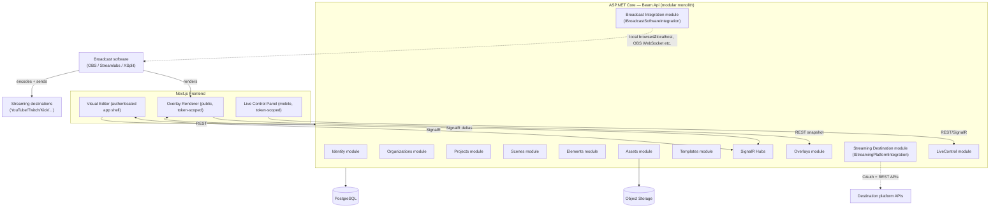
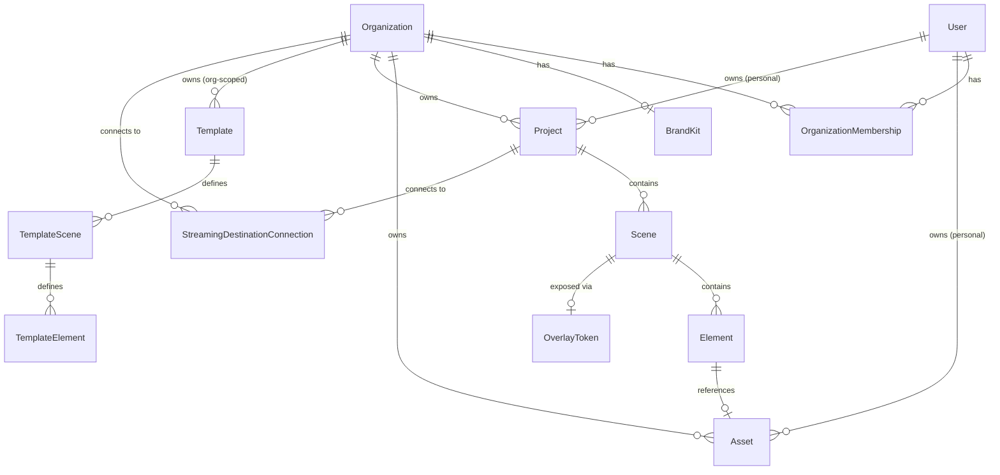

# Beam — Architecture & Technical Design

*"Beam your stream."*

**Beam** is a web-first livestream design and production platform: "Canva/Figma for livestreaming." Users visually design overlays and scenes in the browser; broadcast software (OBS Studio first, others later) renders those designs live via a web/Browser Source. Beam does not capture, encode, mix, or transmit video — that remains the job of the broadcast application.

This document covers sections 1–14 of the requested analysis. The phased build plan is in [ROADMAP.md](ROADMAP.md).

---

## 1–2. Product Analysis & MVP Definition

### The three independent layers

The system has three responsibilities that must never be conflated in code or data model:

| Layer | Responsible for | Examples | Owned by Beam? |
|---|---|---|---|
| **Our platform** | Visual design, scenes, elements, templates, branding, assets, live controls, orgs, collaboration | — | Yes — this is the whole product |
| **Broadcast software** | Camera/screen/game capture, audio mixing, video composition, encoding, recording, sending the broadcast | OBS Studio, Streamlabs Desktop, XSplit | No — we integrate with it, never replace it |
| **Streaming destination** | Distributing the finished stream to viewers, chat, follower/viewer counts | YouTube, Twitch, Kick, Facebook, TikTok | No — we consume its APIs |

Every architectural decision below is downstream of keeping these three layers decoupled. Concretely: **the core domain (Projects/Scenes/Elements/Templates/Overlays) must have zero compile-time or runtime dependency on "OBS" or "Twitch."** Those are adapters plugged in behind interfaces (§11, §14).

### MVP vs. later

| Capability | MVP | Later |
|---|---|---|
| Auth (signup/login) | ✅ | — |
| Create project, choose resolution | ✅ | Custom/arbitrary resolutions beyond presets |
| Scenes: create/rename/duplicate/reorder/delete | ✅ | Configurable transitions between scenes |
| Visual editor: drag/resize/rotate/z-order/opacity/lock/visibility | ✅ | Multi-user concurrent editing (CRDT/OT) |
| Elements: Text, Image | ✅ | Video, Chat, Viewer/Sub count, Alerts, Donations, QR, Countdown, Progress bar, Ticker, Lower third, Sponsor, Carousel, Poll, Scoreboard, Browser embed, Now-playing, Guest name plate, animated elements |
| Overlay renderer, capability-URL, live SignalR sync (no source recreation) | ✅ (this is the MVP's centerpiece) | — |
| Undo/redo, snapping/alignment guides, layer panel | ✅ (basic) | Advanced guides (smart spacing, distribute) |
| Templates | 1–2 seed templates | Full catalog per vertical (gaming, podcast, church, sports, news, corporate, conference, DJ, interview, education, product launch, just-chatting) |
| Organizations / roles / brand kits / locked elements | Data model ready; UI minimal or absent | Full org management, permission matrix, locked template elements |
| Live Control panel (mobile) | Basic scene switch + show/hide element | Full action set (countdown start, ticker toggle, predefined graphics, alert trigger) |
| Broadcast software integration | **None required** — plain Browser Source URL works in any compatible app | `IBroadcastSoftwareIntegration` adapters: OBS WebSocket, then Streamlabs/XSplit if their APIs support it |
| Streaming destination integration | None | `IStreamingPlatformIntegration` adapters: Twitch/YouTube/Kick chat, viewer/sub counts, alerts |
| AI scene/theme generation | None (architecture leaves room, §14 roadmap) | Prompt → generated scenes/elements/theme, still edited via normal editor |

The MVP's "impressive small slice" (per the brief) is exactly: **account → project → scene → editor → save → overlay URL → paste into OBS as Browser Source → live edits propagate without reloading the source.** Nothing else is required to prove the core value proposition, and nothing else should be built before this works end-to-end and reliably.

---

## 3. Major Technical Risks

| Risk | Why it matters | Mitigation |
|---|---|---|
| **CEF lag in browser-source hosts** | OBS/Streamlabs/XSplit embed an older bundled Chromium (CEF). Bleeding-edge CSS/JS may not render as it does in a normal browser. | Target broadly-supported CSS/JS, avoid cutting-edge features (e.g. very new CSS selectors, experimental APIs), and manually verify in real OBS (and later Streamlabs/XSplit) throughout development — Playwright/Chromium is a proxy, not a guarantee. |
| **Design-state vs. live-state confusion** | If "Producer hides lower third during the show" is implemented as *mutating the saved design*, the next time the user opens the editor their layout looks broken. | Model live/ephemeral overrides (current scene, temporary show/hide) as a **separate runtime layer**, never written back into the persisted Scene/Element design (§9). |
| **Overlay reconnect / reload robustness** | Browser sources can reload (OBS setting "refresh browser when scene becomes active", crashes, machine reboot). If the overlay only ever receives *diffs*, a reload leaves it blank or stale. | Overlay client always does REST full-state fetch on load, then layers live SignalR deltas on top. Never rely on the diff stream alone. |
| **Capability-URL security model** | Overlay/live-control endpoints can't do interactive login (CEF browser sources can't complete an OAuth-style flow), so they're secured by an unguessable token in the URL, i.e. bearer-by-URL. | Long random tokens, per-scene scope (leaking one scene's URL doesn't expose the whole project), revoke/rotate support, audit logging of access, no PII or cross-tenant data reachable via the token. |
| **Local-network reachability for native broadcast-software control** | OBS WebSocket (and equivalents) listen on `localhost`/LAN. Our cloud backend cannot reach into a user's home network. This is a fundamentally different networking problem than Browser Source (which is *outbound* from the broadcast app to us). | For same-machine control, the *browser itself* (not our server) opens the WebSocket to `ws://localhost:4455` directly — modern browsers permit HTTPS pages to reach `localhost`. Cross-machine control (e.g. a remote producer controlling a streamer's OBS) requires a relay or local companion — explicitly deferred, documented as a known limitation. |
| **Feature parity assumption across broadcast software** | Streamlabs/XSplit APIs are not OBS WebSocket; feature sets differ or may not exist at all. | `IBroadcastSoftwareIntegration` exposes capability flags; UI never assumes a capability exists — it queries and adapts (§11). |
| **Canvas/editor and overlay renderer drifting apart** | If the editor renders with a canvas library (Fabric/Konva/Pixi) and the overlay renders with plain HTML/CSS, subtle visual differences (font rendering, anti-aliasing, layout rounding) break WYSIWYG trust. | Editor and overlay share the *same* React component tree for rendering elements (§8/§9) — the editor just wraps it with selection/edit chrome. |
| **Undo/redo + future collaboration** | A naive snapshot-diff undo stack becomes hard to reconcile once multiple editors are involved. | MVP: single-editor-at-a-time, explicit invertible **command pattern** for undo/redo (not state snapshots). Multi-user concurrent editing is explicitly out of scope until there's a real need. |
| **Multi-tenant data isolation bugs** | A missed `WHERE OrganizationId = ...` in one new endpoint leaks another org's data — this class of bug is common and severe. | EF Core global query filters scoped to the current tenant context, so isolation is opt-out, not opt-in (§7/§13). |
| **Untrusted file uploads (images especially)** | SVG can carry `<script>`; arbitrary images can carry exploits or be huge. | Server-side re-encode/rasterize (never trust client processing); reject or sanitize SVG; enforce size/type limits; serve uploaded assets from a cookie-less, script-inert origin. |
| **Scope creep from the very long feature list** | The brief lists ~20 element types, ~11 template verticals, 6 roles, 5+ integrations. Attempting breadth before the vertical slice works risks never finishing anything. | Strict phase discipline (ROADMAP.md) — each phase ships something runnable and demoable before the next starts. |

---

## 4. Broadcast Software Research (what's realistically possible)

### Browser Source / web-source model (the MVP mechanism, universal)

This is supported, in some form, by every major broadcast application (OBS Studio, Streamlabs Desktop, XSplit, vMix, and others) because they all embed a Chromium-based browser to render an arbitrary URL as a video source. Key facts that shape the design:

- **It's a one-way outbound connection from the broadcast app to us.** The broadcast app's embedded browser fetches `https://ourapp.com/overlay/{token}` over normal HTTPS/WSS. There is no NAT/firewall/local-network problem — this is why Browser Source is the right *universal fallback*, independent of which broadcast app or OS the user runs.
- **The embedded browser is not evergreen.** It ships with the app and updates on the app's release cadence, so it can lag behind current Chrome by version(s). Avoid relying on brand-new CSS/JS features; test against the real embedded browser regularly, not just a dev-machine Chrome tab.
- **No reload needed for updates**, provided the page itself keeps a persistent connection (SignalR/WebSocket) and mutates the DOM in place rather than navigating. This is exactly the mechanism the "no source recreation" requirement needs, and it works with **zero native API integration** — it's plain client-side JS running inside whatever browser the host embeds.
- **Transparency**: browser sources default to a transparent background (unless the page itself paints one), which is required for overlay compositing — our renderer must leave `html/body` transparent except where an element explicitly has a background.
- **Sizing**: the host is told a fixed width/height for the source. Our overlay page should target the project's configured resolution 1:1 and let the host scale/letterbox if the user sets the source dimensions differently — we should surface the expected width/height clearly in the UI when generating the URL.
- **Reload can happen outside our control** (host setting "refresh browser when scene becomes active," crashes, restarts) — hence the full-resync-on-load requirement above.
- **Audio** can play from a browser source (useful later for alert sounds) — not an MVP concern, but doesn't require anything special from us either.

Conclusion: **Browser Source support requires no vendor-specific integration code at all.** It is a property of the overlay renderer being a well-behaved, resilient, self-resyncing web page — which makes it automatically compatible with OBS, Streamlabs, XSplit, or anything else with a browser/web source, without us writing an adapter for each one. This is why it's correctly positioned as the "universal fallback" rather than an "OBS feature."

### Native control APIs (deeper integration, later, per-app)

These are genuinely different per application and must be verified per app before building against them:

- **OBS Studio**: OBS WebSocket v5 is built into OBS 28+ (no plugin needed), listens on `localhost:4455` by default, password-protected, JSON-RPC-style protocol over WebSocket. Supports: create/remove sources (including browser sources), list/switch scenes, show/hide sources, start/stop streaming, start/stop recording, read streaming/recording status, and more. This is the most mature and best-documented option and is why OBS is the correct first native target.
- **Streamlabs Desktop**: has its own API surface (historically an SLOBS API distinct from OBS WebSocket, since Streamlabs Desktop is a fork of OBS with its own control layer). Feature set and auth model must be verified independently before implementation — do not assume it mirrors OBS WebSocket.
- **XSplit**: has historically exposed a scripting/API surface of its own, again distinct from OBS WebSocket. Must be independently verified.
- **Common constraint across all of them**: these control APIs run on `localhost`/LAN on the user's machine, not on the public internet. A cloud backend cannot dial into them directly. Two viable patterns:
  1. **Direct browser-to-local-app connection** — our web app's JS, running in the *user's own browser tab on the same machine as the broadcast app*, opens the WebSocket directly to `localhost`. This works today (browsers allow HTTPS pages to reach `localhost`) and means **the control app's credentials never need to touch our servers** — a meaningful security simplification. This only works when the person operating the control panel is on the same machine as the broadcast software.
  2. **Local companion/relay** — needed only if we want cross-machine control (e.g., a remote producer, on a different computer, driving a streamer's OBS). Explicitly out of scope until there's demonstrated demand; the brief already excludes a desktop companion from the MVP.

### Capability model

Because feature sets differ per broadcast app (and evolve over time), every native integration must self-describe what it supports rather than the application assuming parity:

```csharp
public interface IBroadcastSoftwareIntegration
{
    string ProviderId { get; }              // "obs", "streamlabs", "xsplit"
    BroadcastSoftwareCapabilities Capabilities { get; }

    Task<ConnectionResult> ConnectAsync(...);
    Task<IReadOnlyList<BroadcastScene>> GetScenesAsync();
    Task SwitchSceneAsync(string sceneId);
    Task SetSourceVisibilityAsync(string sourceId, bool visible);
    Task<BroadcastStatus> GetStatusAsync();
    Task StartStreamingAsync();   // may throw NotSupportedByProviderException
    Task StopStreamingAsync();
    Task StartRecordingAsync();
    Task StopRecordingAsync();
}

public record BroadcastSoftwareCapabilities(
    bool SupportsCreateSource,
    bool SupportsSceneSwitching,
    bool SupportsSourceVisibility,
    bool SupportsStatusMonitoring,
    bool SupportsStreamingControl,
    bool SupportsRecordingControl);
```

The UI queries `Capabilities` and only renders controls for what the connected integration actually supports — it never hardcodes "OBS can do X." `ObsIntegration` is the first (and, for MVP+1, only) implementation; `StreamlabsIntegration`/`XSplitIntegration` are added later behind the same interface without touching the core domain. **The product must work fully (via Browser Source) with zero implementation of this interface** — native integrations are a convenience layer on top of an already-functional product, not a dependency of it.

---

## 5. Recommended Technology Stack

| Concern | Choice | Why |
|---|---|---|
| Backend framework | ASP.NET Core (.NET 10 LTS) | Matches your existing expertise; .NET 10 is the current LTS as of this build |
| ORM | EF Core 10, PostgreSQL provider | First-class jsonb support (`ToJson()` owned entities) fits the hybrid relational/flexible-schema element model (§7) |
| Database | PostgreSQL 16+ | jsonb, strong indexing, free/open, trivial in Docker |
| Real-time | ASP.NET Core SignalR | Native to the stack; in-memory is fine for single-instance MVP, Redis backplane is a drop-in later for horizontal scale |
| Validation | FluentValidation | Keeps validation out of controllers/domain, testable in isolation |
| Logging | Serilog (console + JSON sink; Seq/ELK later) | Structured logging is a stated requirement |
| Exception handling | `IExceptionHandler` (.NET 8+) → RFC 7807 `ProblemDetails` | Centralizes error shaping, avoids leaking internals |
| Frontend framework | Next.js (App Router), React, TypeScript | Matches the brief; App Router's route groups map cleanly onto "authenticated app shell" vs. "public overlay" vs. "public control panel" needing very different layouts/bundles |
| Styling | Tailwind CSS | As specified |
| Editor state | Zustand (+ an explicit undo/redo command stack, not snapshot-diffing) | Lightweight, no Redux boilerplate; command pattern gives clean, invertible undo/redo semantics that scale toward future collaboration |
| Canvas interaction | DOM elements positioned with CSS transforms + **react-moveable** for drag/resize/rotate/snap handles | See below — deliberately *not* a canvas/WebGL library |
| Real-time client | `@microsoft/signalr` | Official JS client, matches backend |
| Object storage | S3-compatible (MinIO in Docker Compose locally; S3/R2 in prod) behind `IFileStorageService` | Avoids vendor lock-in, standard local-dev story |
| Image processing | SixLabors.ImageSharp | Pure .NET, no native library headaches, used to re-encode/validate/thumbnail all uploads server-side |
| Backend tests | xUnit, FluentAssertions, Testcontainers (real Postgres) | Integration tests against a real DB catch EF/query-filter bugs that mocks hide |
| Frontend tests | Vitest + React Testing Library; Playwright for e2e | Playwright is a good proxy for browser-source rendering, but real OBS verification remains necessary (§3) |
| Local infra | Docker Compose: postgres, minio, api, web | Redis is deliberately **not** in the MVP compose file — added only when horizontal scaling of SignalR/live-state is actually needed |

### Why DOM + react-moveable instead of a canvas library (Fabric/Konva/Pixi)

This is the single highest-leverage frontend decision, so it's worth stating explicitly. If the editor renders elements onto a `<canvas>` (Fabric/Konva/Pixi) but the overlay renders the same design as HTML/CSS (which it must — a Browser Source is a *web page*, not a video blob we control), you end up maintaining **two independent rendering engines** for the same visual output, and they will drift (font metrics, anti-aliasing, animation timing, text wrapping). By building the editor's elements as real DOM nodes positioned with `transform: translate() rotate()`, the exact same React rendering logic (a shared "scene renderer") can be used for both:

- **Editor**: scene renderer + an interactive overlay of selection handles, rulers, snap guides (react-moveable) on top.
- **Overlay**: scene renderer alone, read-only, wired to live SignalR state, no editor chrome.

This guarantees WYSIWYG by construction rather than by careful parallel maintenance, and it's the pattern used by essentially every real "Canva-for-X" product for this exact reason.

---

## 6. High-Level Architecture

**Modular monolith**, one deployable ASP.NET Core process, internally partitioned into modules with enforced boundaries via .NET project references (a module cannot reach another module's internals without an explicit, intentional reference to its public contracts). No microservices for MVP — nothing here has an independent scaling or deployment need that justifies the operational cost.



Module boundaries (mirrors the folder structure in §13):

| Module | Owns | Depends on |
|---|---|---|
| Identity | Users, auth, sessions | Shared kernel only |
| Organizations | Orgs, membership, roles, brand kits | Identity |
| Projects | StreamProject | Organizations, Identity |
| Scenes | Scene | Projects |
| Elements | Element, element-type registry | Scenes, Assets |
| Assets | Upload, storage, processing | Organizations/Identity (ownership) |
| Templates | Template catalog, instantiation into Scenes/Elements | Scenes, Elements, Organizations |
| Overlays | Capability tokens, state-snapshot composition, public read API | Scenes, Elements, LiveControl |
| LiveControl | Ephemeral live-session state, control actions | Scenes, Elements |
| Broadcast Integration | `IBroadcastSoftwareIntegration` + adapters | Overlays (to know what to expose), nothing else in core domain depends on *it* |
| Streaming Destination | `IStreamingPlatformIntegration` + adapters | Nothing in core domain depends on *it*; Elements (Chat/ViewerCount/SubCount) consume its normalized data via an interface, not a concrete provider |

The dependency direction is deliberate: **core domain modules (Projects/Scenes/Elements/Templates/Overlays) never reference Broadcast Integration or Streaming Destination.** Those two integration modules depend inward on the domain (to read scene/element data, to know what needs displaying), never the other way around. This is what makes "add another broadcast app" or "add another streaming platform" an additive change rather than a domain rewrite.

---

## 7. Domain / Database Model

### Entity overview



### Key entities

- **User** — id, email, password hash (or external auth), display name.
- **Organization** — id, name, plan. `OrganizationMembership(userId, organizationId, role)` — role ∈ {Owner, OrgAdmin, Streamer, Producer, Designer, Moderator}.
- **Project (StreamProject)** — id, `OwnerType` (User | Organization) + owner id, name, `ResolutionWidth`, `ResolutionHeight`, timestamps. A personal project has a user owner and no org; an org project has an org owner.
- **Scene** — id, projectId, name, `OrderIndex`, optional `TransitionConfig` (jsonb, later phase).
- **Element** — hybrid model, deliberately *not* one table per element type:
  - Real relational columns for the properties every element shares and that need querying/sorting/constraints: `X, Y, Width, Height, Rotation, ZIndex, Opacity, Locked, Visible, Name, Type (discriminator)`.
  - A `Config` `jsonb` column (EF Core `ToJson()` owned type) for type-specific properties (font/size/weight/alignment for Text; src/fit for Image; data-binding source for Chat/ViewerCount; etc.).
  - Optional `SourceTemplateElementId` + `EditableProperties` (string list) — set when an element originates from an org template, enabling the locking model (§ below) without a separate table per lock rule.
  - This avoids both "one giant table with 40 mostly-null columns" and "a table per element type" (which would make the generic layer panel/z-order/selection logic painful to write generically).
- **Asset** — id, owner (user or org), `Type` (Image/Video/Font/Logo), storage key, mime type, size, processed variants (thumbnail key, etc.).
- **Template** — id, name, category, scope (System/Organization), definition (a snapshot of scenes/elements to instantiate, or normalized child rows — see ROADMAP Phase 5 for the trade-off).
- **BrandKit** — id, organizationId, colors[], fonts[], logo asset ids, watermark asset id, default lock policy.
- **OverlayToken** — id, scope (ProjectId or SceneId), token (random, unique, indexed), `RevokedAt`, `LastAccessedAt`. This is the capability-URL credential (§3).
- **LiveSession** (mostly ephemeral, see §9) — id, projectId, `CurrentSceneId`, started/ended timestamps. Live overrides (element visibility toggles during a broadcast) live in an in-memory/Redis store keyed by `LiveSession.Id`, not in `Element` rows.
- **BroadcastConnectionPreference** *(client-side concept, not server-persisted credentials)* — if we persist anything at all server-side for convenience (e.g. "this project's preferred provider is OBS"), it is non-secret metadata only. OBS WebSocket host/port/password are kept in the browser (localStorage) for the direct browser→localhost pattern (§4) and are never sent to our API.
- **StreamingDestinationConnection** — id, owner (user or org), `Provider` (YouTube/Twitch/Kick/Facebook/TikTok), encrypted OAuth tokens (ASP.NET Core Data Protection or KMS-backed encryption at rest), scopes, expiry, status. Concrete provider quirks live entirely inside the adapter; this table only stores the generic shape.

### Multi-tenancy

Every tenant-scoped entity carries an owner discriminator (`OrganizationId` or `OwnerUserId`). EF Core **global query filters**, driven by an `ITenantContext` resolved from the authenticated principal per request, are applied to every tenant-scoped `DbSet`. This makes isolation opt-out (you'd have to deliberately call `.IgnoreQueryFilters()`) rather than opt-in (forgetting a `.Where(...)`), which is the single best mitigation for the "leaked another org's data" risk class.

### Template locking model

An org template's elements carry `EditableProperties` (e.g. `["text", "cameraSourceId"]`). When a template is instantiated into a project, each resulting `Element` keeps `SourceTemplateElementId` and inherits that whitelist. The editor UI and the API both enforce it: a Streamer can `PATCH` the whitelisted properties of that element; attempting to move, resize, or delete a non-whitelisted/locked element (e.g. the company logo, watermark, required sponsor graphic) is rejected server-side, not just hidden in the UI (per the brief's explicit "proper authorization, not just hiding UI" requirement).

---

## 8. Frontend Architecture

Next.js App Router, three distinct "surfaces" that intentionally do **not** share a layout or bundle, because they have very different constraints:

```
/app
  /(marketing)/...              # public marketing pages
  /(app)/...                    # authenticated app shell: dashboard, projects, editor, org settings
  /overlay/[token]/page.tsx     # PUBLIC, no auth, no app chrome — must be small & fast, runs inside a broadcast app's embedded browser
  /control/[token]/page.tsx     # PUBLIC (token-scoped), mobile-first live control panel
```

- `(app)` pulls in the full editor stack (react-moveable, Zustand store, layer panel, etc.).
- `/overlay/[token]` pulls in **only** the shared scene renderer package + the SignalR client — no editor chrome, no auth libraries, minimal CSS. Next.js route-based code splitting keeps this bundle lean automatically as long as the overlay route doesn't import editor-only modules.
- `/control/[token]` is a small, mobile-optimized page hitting the LiveControl API/hub.

### Shared scene renderer

A single package/module (`/web/packages/scene-renderer` if using a pnpm/Turborepo workspace, or `/web/lib/scene-renderer` if kept simple within one app) exports a pure function/component: `SceneRenderer(scene: SceneDto): JSX.Element`, mapping the Element type registry to React components (`TextElement`, `ImageElement`, `CameraPlaceholderElement`, ...). Both the editor (wrapped in `<EditableCanvas>` with selection/handles) and the overlay (`<LiveOverlay>` with SignalR-driven state) render through this same function. This is the mechanism that guarantees WYSIWYG (§5).

### Editor state & undo/redo

- Zustand store holds the current scene's element list + selection state.
- Every mutation (move, resize, rotate, style change, add, delete, reorder) is expressed as an explicit `Command` object with `apply()`/`invert()`. Commands push onto an undo stack; undo/redo replays `invert()`/`apply()`. This is more robust than diffing snapshots and generalizes cleanly if/when multi-user editing is tackled later (commands are also the natural unit to broadcast to collaborators).
- Autosave: commands are also debounced and persisted via `PATCH` to the API; explicit "Save" is a user-visible confirmation of the same underlying autosave, not a distinct code path.

### Canvas interactions

`react-moveable` (or `interact.js` if a specific need arises) drives drag/resize/rotate, snapping to guides and to other elements' edges, and multi-select. It emits geometry deltas which the editor turns into `Command` objects — it does not own persistence or rendering, keeping the interaction library swappable if a better option emerges later.

---

## 9. Overlay Rendering Architecture

```
Visual Editor  →  Scene/Element JSON (persisted)  →  Overlay Renderer  →  Web/Browser Source (any broadcast app)
```

### Design state vs. live state (the key insight from §3)

Two layers are composed at render time, and only one of them is ever persisted as "the design":

1. **Design state** — the saved Scene/Element rows. Edited only through the visual editor. This is what you see when you reopen the editor tomorrow.
2. **Live state** — ephemeral overrides that exist only while a `LiveSession` is active: which scene is currently "on air," temporary show/hide toggles fired from the Live Control panel, an active countdown's target end-timestamp, etc. Stored in-memory (MVP, single instance) or Redis (once horizontally scaled) keyed by `LiveSession.Id`. Never written into `Element.Visible` or similar design columns.

The overlay's rendered output is `merge(DesignState, LiveStateOverrides)`. A producer hiding the lower third mid-show never corrupts the saved layout.

### Load & resync sequence (must be reload-safe)

1. Broadcast app's embedded browser requests `GET /overlay/{token}` → server resolves token → scene design + any active live overrides, rendered as the initial HTML/CSS (fast first paint, no flash of empty content).
2. Page JS opens a SignalR connection to the `LiveHub`, joins the group for that scene/project.
3. On connect (including *reconnect* after a browser-source reload), the client calls a hub/REST method to fetch a **full current snapshot** again and reconciles — it never assumes the diff stream picks up where it left off.
4. Subsequent server pushes (`ElementUpdated`, `ElementAdded`, `ElementRemoved`, `SceneActivated`, `LiveOverrideChanged`) are applied incrementally to already-rendered DOM — no navigation, no source recreation, exactly per the "no reload" requirement.

### Countdown/timer correctness

Timers are driven by a server-anchored target timestamp (`EndsAtUtc`), not a client-side decrementing counter with no anchor — so a reconnect (or a second viewer, e.g. a preview tab) always computes the same remaining time instead of drifting or resetting.

---

## 10. Real-Time Communication Architecture

Single ASP.NET Core SignalR hub family, in-memory for MVP (single backend instance — entirely adequate at this stage; a Redis backplane is a configuration change, not a redesign, when/if multiple instances are needed):

- **`EditorHub`** — used by the editor for its own live autosave feedback and, later, multi-user presence/collaboration. Not required for MVP beyond what autosave over REST already provides.
- **`LiveHub`** — the one that matters for the core slice:
  - **Overlay clients** (running inside the broadcast app's browser source) join a group keyed by project/scene and *receive* state.
  - **Control clients** (editor "preview" and the mobile Live Control panel) *send* server methods (`TriggerAction(sceneId, actionType, payload)`).
  - The server always mediates: a control client's request is authorized (is this user allowed to control this project?) before the server rebroadcasts to the relevant overlay group. Control clients never broadcast to each other directly.

This single-hub-two-roles design avoids introducing a separate hub per feature while keeping a clean security boundary (only the server decides what gets rebroadcast).

---

## 11. Broadcast Software & Streaming Destination Integration Strategy

Two **separate** abstractions, deliberately not combined (per the brief):

```csharp
// Renders/controls the local broadcast application. Optional — the product
// works fully without any implementation of this via Browser Source.
public interface IBroadcastSoftwareIntegration { /* §4 */ }

// Talks to a cloud streaming platform's API for chat, viewer/sub counts,
// stream metadata, alerts/events. Entirely server-side (OAuth).
public interface IStreamingPlatformIntegration
{
    string ProviderId { get; }                    // "twitch", "youtube", "kick", "facebook"
    StreamingPlatformCapabilities Capabilities { get; }

    Task<OAuthResult> CompleteAuthAsync(string code);
    Task<ChannelInfo> GetChannelInfoAsync();
    Task<ViewerMetrics> GetViewerMetricsAsync();
    IAsyncEnumerable<ChatMessage> StreamChatAsync(CancellationToken ct);
}
```

- `Elements` (Chat, ViewerCount, Sub/FollowerCount) consume **normalized DTOs** (`ChatMessage`, `ViewerMetrics`) produced by whichever `IStreamingPlatformIntegration` is connected — the Chat element component has no idea whether the data came from Twitch or YouTube.
- Rollout order: (1) Browser Source works with zero integrations of either kind — this is the MVP. (2) `ObsIntegration : IBroadcastSoftwareIntegration` — deeper local control, after the Browser Source workflow is proven (per your instruction). (3) `IStreamingPlatformIntegration` adapters (Twitch/YouTube first, most complete public APIs) for chat/viewer-count elements. (4) Additional broadcast software (Streamlabs, then XSplit) *if* their control APIs, once researched, justify it — each is an additive adapter, never a core-domain change.
- Credentials custody differs sharply between the two: broadcast-software credentials (OBS WebSocket password) are best kept **client-side only** (§4) since the control connection is local-machine-to-local-machine; streaming-destination OAuth tokens are properly server-side secrets (encrypted at rest, never returned to the frontend beyond a connection status).

---

## 12. Authentication & Authorization

- **Authentication**: ASP.NET Core Identity as the user store. Cookie-based session auth (`HttpOnly`, `Secure`, `SameSite=Lax`) rather than JWT-in-localStorage, to avoid exposing tokens to JS/XSS — Next.js and the API are placed behind the same origin (path-based reverse proxy, e.g. `/api/*` → backend) in production so cookies work simply; CORS + relaxed `SameSite` only in local dev where ports differ.
- **Public, unauthenticated surfaces** (`/overlay/{token}`, `/control/{token}`) use the capability-token model exclusively (§3/§9) — no cookies, no login, by necessity (a browser source can't complete an interactive login).
- **Authorization**: policy-based (`[Authorize(Policy = "...")]`) backed by a central permission-checking service, not scattered role-string checks in controllers. Two dimensions:
  1. **Tenant scope** — enforced structurally via EF Core global query filters (§7), so you cannot accidentally query outside your org/personal scope.
  2. **Role + resource rules** — Owner/OrgAdmin/Streamer/Producer/Designer/Moderator map to a fixed permission set for MVP (a full custom-role/permission-matrix engine is explicitly not needed yet — it's a straightforward upgrade later if a customer asks for custom roles). Template element locks (§7) are enforced in the same policy layer, server-side, so a locked logo can't be moved by crafting a raw API request even if the UI wouldn't offer that option.
- **Third-party OAuth tokens** (streaming destinations): stored encrypted at rest, never serialized to the frontend; the frontend only ever sees `{ provider, connectedAsDisplayName, status }`.
- **Broadcast-software credentials** (OBS WebSocket password): kept client-side (browser localStorage) per §4/§11 — a deliberate choice to *reduce* what our servers need to protect, not an oversight.

---

## 13. Repository / Folder Structure

```
/Beam.sln
/src
  /Beam.Api                    # composition root: minimal API/controllers, SignalR hubs, DI wiring, middleware
  /Beam.Modules
    /Beam.Modules.Identity
    /Beam.Modules.Organizations
    /Beam.Modules.Projects
    /Beam.Modules.Scenes
    /Beam.Modules.Elements
    /Beam.Modules.Assets
    /Beam.Modules.Templates
    /Beam.Modules.Overlays
    /Beam.Modules.LiveControl
    /Beam.Modules.BroadcastIntegration     # IBroadcastSoftwareIntegration + Obs adapter (later: Streamlabs, XSplit)
    /Beam.Modules.StreamingDestinations    # IStreamingPlatformIntegration + Twitch/YouTube adapters (later)
  /Beam.Shared                 # cross-cutting primitives (Result<T>, domain exceptions, base entities)
  /Beam.Infrastructure         # EF Core DbContext + migrations, storage/email/encryption implementations
/tests
  /Beam.Api.Tests
  /Beam.Modules.*.Tests        # one test project per module boundary
/web
  /app
    /(marketing)
    /(app)
    /overlay/[token]
    /control/[token]
  /components
  /features                    # editor/, scenes/, elements/, templates/, live-control/
  /lib                          # api client, signalr client, generated types
  /packages/scene-renderer      # shared editor/overlay rendering package
/docs
  ARCHITECTURE.md
  ROADMAP.md
/docker-compose.yml
/docker-compose.override.yml   # local dev overrides
```

Module boundaries are enforced by project references: `Beam.Modules.Elements` may reference `Beam.Modules.Scenes` and `Beam.Modules.Assets`; nothing in `/Beam.Modules` (other than `BroadcastIntegration`/`StreamingDestinations` themselves) references either integration module — enforced by simply not adding the project reference, which the compiler makes impossible to fake.

---

## 14. Open Trade-offs Worth Revisiting

- **MediatR/CQRS**: not adopted for MVP — plain service classes per module keep things simple, per "avoid unnecessary microservices/complexity." Revisit only if in-module cross-cutting (logging, validation, notifications) becomes genuinely painful with plain DI.
- **Template storage** (definition snapshot vs. normalized rows): start with a JSON snapshot instantiated into real Scene/Element rows on "use template" — simplest to implement and version. Revisit if templates need to stay "live-linked" to their source (e.g. org updates a template and wants existing projects to optionally re-sync) — not required for MVP.
- **Redis**: intentionally absent from the MVP Docker Compose. Added when either SignalR needs a multi-instance backplane or live-session state needs to survive a process restart — neither is true at MVP scale.

See [ROADMAP.md](ROADMAP.md) for the phased build plan.
